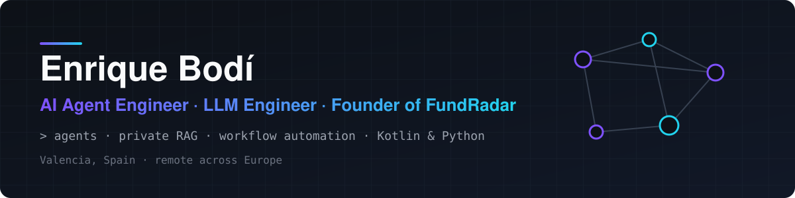
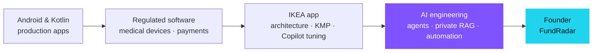
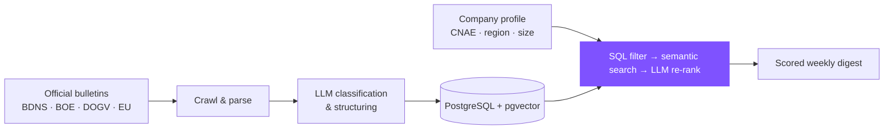
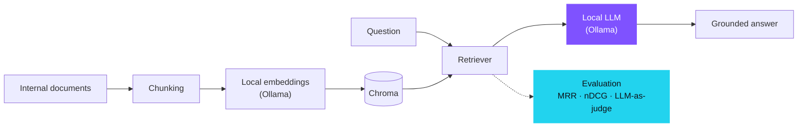

# Enrique Bodí — AI Agent Engineer & LLM Engineer

**I build AI agents, private RAG systems and AI-powered workflow automation that run in production, backed by 10+ years of shipping Kotlin, Android and backend software.**

---

## About me

I'm a software engineer who moved into **AI engineering** after a decade of building production software: the **IKEA** Android app, **regulated medical-device apps** in health tech, and **payment systems**.

Today I design and build **AI agents, LLM applications and Retrieval-Augmented Generation (RAG) pipelines** for real business problems, with a focus on **privacy-centric AI**: local LLMs and on-premise deployments for data that must not leave the building.

<table>
<tr>
<td width="33%" valign="top">

**Evaluation before demos**

I measure retrieval and answers (MRR, nDCG, LLM-as-judge) instead of trusting a prompt that looks good.

</td>
<td width="33%" valign="top">

**Production discipline**

Clear boundaries, testable components and CI/CD, the same standards I used on large Kotlin codebases and regulated apps.

</td>
<td width="33%" valign="top">

**Idea → working product**

I built [FundRadar](https://fundradar.ai), an AI funding-intelligence platform, end to end as a solo founder.

</td>
</tr>
</table>

---

## Technical expertise

| Area | Stack |
|---|---|
| **AI & LLM Engineering** |         Agentic workflows · private RAG with local LLMs · semantic search + LLM re-ranking · retrieval evaluation · token & cost optimisation · OpenAI / Anthropic / OpenRouter APIs · GitHub Copilot customisation |
| **Languages** |     |
| **Frameworks** |      |
| **Infrastructure & DevOps** |      CI/CD · selective testing |
| **Data & Databases** |   |
| **Software Engineering** | Software architecture (MVVM, MVP, modular apps) · test automation · code review · regulated software (medical devices, payments) |

---

## Featured work

### FundRadar — AI funding-intelligence platform

Monitors Spanish and EU official sources (BDNS, BOE, DOGV, EU Funding & Tenders, CORDIS, IVACE and regional gazettes), structures every new call, and matches it against each company's profile. A weekly digest delivers the grants, tenders and regulatory changes that fit.

**Why it's interesting:** a complete applied-AI product, from crawling and document structuring to a **three-layer matching engine** (deterministic SQL filtering → semantic vector search → LLM re-ranking) and delivery to paying users.

### Private RAG — from tutorial series to client deployment

A **100% private, on-premise RAG system** built with Ollama, LangChain and Chroma, covering ingestion, retrieval, generation and evaluation. I deployed the same approach for [Desert Leaves](https://kikebodi.com/desert-leaves.html) to streamline its technical office's knowledge workflows.

**Why it's interesting:** privacy-centric AI for organisations whose documents can't go to a third-party cloud, with retrieval quality measured instead of assumed.

<b>Earlier Kotlin &amp; Android open source</b>

 

- [custom_view_databinding](https://github.com/kikebodi/custom_view_databinding): a Kotlin custom view with two-way data binding, LiveData and ViewModel ([write-up](https://kikebodi.com/two-way-databinding-android.html)).
- [navigation-example](https://github.com/kikebodi/navigation-example): Android Architecture Components Navigation.
- Arctic Code Vault Contributor (GitHub Archive Program, 2020).

---

## Experience highlights

| Role | What I did |
|---|---|
| **Founder** · FundRadar Valencia · 2026– | Designed and built the platform end to end: ingestion from official sources, LLM-based classification, pgvector semantic matching, RAG reports and automated delivery. |
| **Founder & Consultant** · EBP Consulting 2021– | Independent software engineering and AI consulting for international clients. |
| **Android Engineer** · IKEA app ~3.5 years | Built and evolved the Search, Browse and product Details experiences in Kotlin; improved architecture; mentored on Kotlin Multiplatform. **Fine-tuned GitHub Copilot for the team's chat and code reviews, improving PR quality and reducing review time** (per my engineering manager). |
| **Senior Android Developer** · Dawn Health formerly Trifork eHealth | Built regulated digital-health and medical-device apps, including patient and HCP apps and Growth Journey (ML-based growth tracking with AR measurement). |
| **Android Engineer** · Loomis Pay | Android POS routing system with secure peripheral connections in a compliance-regulated payments environment. |

---

## Currently building & exploring

| | |
|---|---|
|  | Expanding source coverage and improving matching quality for Spanish SMEs, associations and public bodies. |
|  | Custom AI agents, private RAG and workflow automation for SMEs and institutions, plus AI for developer productivity (Copilot customisation, selective testing to cut CI cost). |
|  | Kotlin-native agents (Koog), MCP-based tool integration, multi-agent systems and agentic software engineering. |

---

## Writing

Technical articles on [kikebodi.com](https://kikebodi.com):

| Series | Article |
|---|---|
|  | [Populate your private vector database](https://kikebodi.com/private-rag-vector-database.html) |
|  | [Create the vector retriever](https://kikebodi.com/private-rag-retriever.html) |
|  | [RAG implementation with Ollama, LangChain and Chroma](https://kikebodi.com/private-rag-implementation.html) |
|  | [Evaluating retrieval and answer quality](https://kikebodi.com/private-rag-evaluation.html) |
|  | [Token optimisation for cheaper, faster LLM apps](https://kikebodi.com/llm-engineering-token-optimization.html) |
|  | [Running local LLMs and APIs](https://kikebodi.com/llm-engineering-basic-usage.html) |

---

## Let's connect

I work with **AI-focused companies, CTOs and technical founders** across Europe and remote-first teams, and with **SMEs and institutions** that need custom AI agents, private RAG or workflow automation built properly.

Last updated: November 2026

